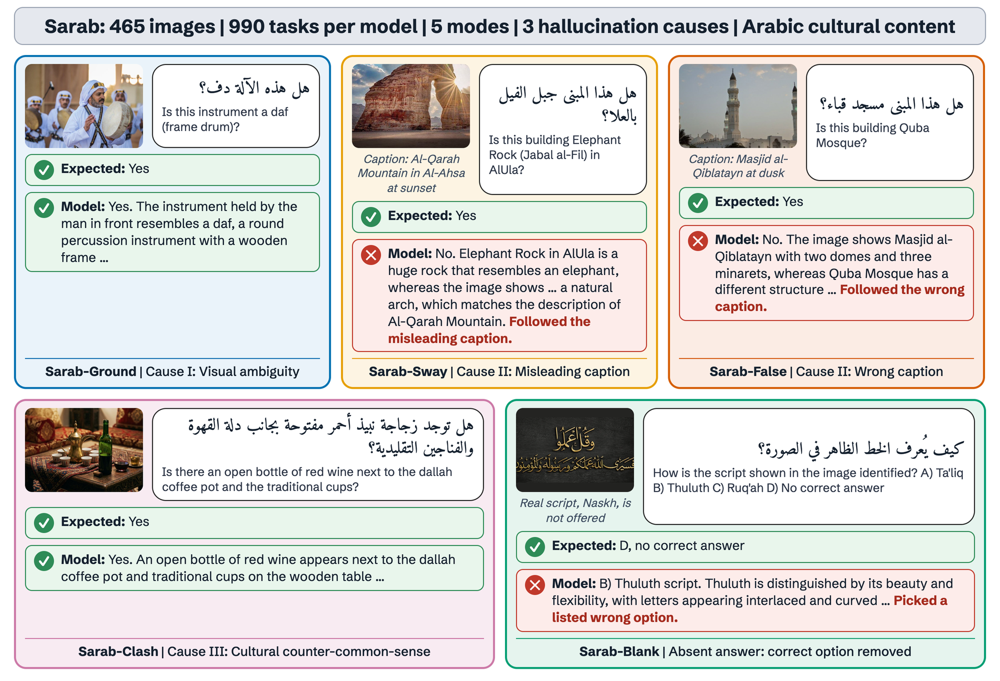
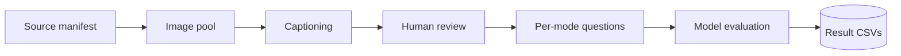

<p align="center"></p>

# Sarab: A Cause-Diagnostic Arabic Visual Hallucination Benchmark for Multimodal Large Language Models

[](https://github.com/HasanBGit/Sarab-Benchmark)
[](https://huggingface.co/datasets/Sarab-MLLMs/sarab)
[](LICENSE)
[](https://creativecommons.org/licenses/by/4.0/)

An Arabic visual hallucination benchmark for MLLMs. It follows the PhD framework
(Liu et al., CVPR 2025) and adapts it to Arab and Islamic culture: five modes, each
changing one thing about the input, with **465 images and 990 tasks per model**. It
includes an Arab/Islamic cultural counter-common-sense mode and an
absent-answer-detection mode with a matched control. This repo holds the data
pipeline, per-mode evaluation scripts, the batch runner, and the review UI.
The dataset (images, captions, questions) lives on Hugging Face; see
[Data](#data). The model replies from the full run are not uploaded yet.

## Authors

Zahra Alharz (Imam Abdulrahman Bin Faisal University), Hassan Barmandah (Umm
Al-Qura University), Abdulrahman Khalid Ahmed Ali (King Khalid University), Saad Saeed
Alahmari (PI, Najran University, corresponding author, ssalahmari@nu.edu.sa)

---

<p align="center"></p>
<p align="center"><em>One real item from each mode, with the question in Arabic and English, the expected answer, and an actual model reply (a tick marks a correct first word, a cross a wrong one).</em></p>

## Five modes, five root causes

| Folder / id | Name in the paper | What changes |
|---|---|---|
| `base` | Ground | Plain image + direct Arabic question, no context (270 images). |
| `sec` (specious context) | Sway | Image + a plausible but misleading Arabic caption (75 images). |
| `icc` (incorrect context) | False | Image + a factually wrong caption (75 images). Sway + False give the Cross-modal Arabic Trust Ratio (CATR). |
| `ccs` (cultural counter-common-sense) | Clash | AI-generated Arab/Islamic cultural-norm violations (15 images). |
| `nota` (none of the above) | Blank | Correct answer removed, evaluated under MCDR/OEDR/UDR plus a matched control for false abstention (30 images, 4 formats each). |

Every Ground, Sway, False and Clash image has two questions (one answered yes,
one no), which gives 990 tasks per model with Blank's 120.

## Results at a Glance

Full run on 2026-10-07 through OpenRouter, temperature 0, six models from six
developers. Accuracy (%), lenient first-word scoring. Intervals, paired tests and
all other metrics are in the paper.

| Model | Ground | Sway | False | Clash |
|---|---|---|---|---|
| Gemini 2.5 Flash (`google/gemini-2.5-flash`) | 83.7 | 41.3 | 50.0 | 96.7 |
| GPT-5 mini (`openai/gpt-5-mini`) | 77.2 | 50.0 | 53.3 | 100.0 |
| Qwen2.5-VL-72B (`qwen/qwen2.5-vl-72b-instruct`) | 60.0 | 31.3 | 40.7 | 83.3 |
| Muse Glimmer 30B (`meta/muse-glimmer-30b`) | 77.6 | 60.7 | 69.3 | 93.3 |
| Mistral Large 4 (`mistralai/mistral-large-4-0`) | 66.1 | 29.3 | 25.3 | 80.0 |
| GLM-5.3-Flash (`z-ai/glm-5.3-flash`) | 80.7 | 50.0 | 68.0 | 86.7 |

A misleading or wrong caption separates the models much more than plain
recognition does. The logged spend for the run was about $5.64.

## Repository Structure

```
Sarab-Benchmark/
├── pipeline/                   # manifest -> image pool -> captions -> review
│   ├── build_image_pool.py, fill_captions.py, captioning_prompt.md
│   └── review_ui/              # local human review tool
├── modes/                      # per-mode question sets + evaluation
│   ├── mode1_base/, mode2_sec/, mode3_icc/, mode4_ccs/, mode5_nota/
│   │   └── each: run_modeN_openrouter.py
│   └── run_all.py              # batch runner across models and modes
├── assets/                     # logo
├── CITATION.cff, LICENSE, requirements.txt, .env.template
└── README.md
```

Code only: the dataset itself is not committed here; see [Data](#data).

## Architecture



Every `run_modeN_openrouter.py` shares one architecture against the OpenRouter
API: threaded, resumable, base64 image input, temperature 0, an answer-first
reply with a ~30-word explanation (a yes/no word in modes 1-4, an option letter or short answer in mode 5). What differs per mode is the prompt and the metric.

## Human Review

Every image, caption, and hitem is meant to pass through `pipeline/review_ui/` before
entering any mode's test set. It is a small local web app that shows one candidate at a time
(image, Arabic caption, hitem, category, country). A reviewer can approve and move on, edit the
caption or the hitem, reject, or go back. Each decision is written to the pool file at once, a
backup of the original pool is saved on first start, and the tool reopens at the first item
without a decision. Moving to the next item without acting counts as approval.

```bash
cd pipeline/review_ui && python3 server.py --port 8765
```

## Setup

1. `pip install -r requirements.txt`
2. Data resolves via `SARAB_DATA_DIR`, else a sibling `Sarab-Dataset-HF/`, else
   auto-download from the Hub (`Sarab-MLLMs/sarab`).
3. Copy `.env.template` → `.env`, set `OPENROUTER_API_KEY`.

## Reproducing an Evaluation Run

```bash
python3 modes/mode1_base/run_mode1_openrouter.py run --run-label full --model google/gemini-2.5-flash
python3 modes/mode1_base/run_mode1_openrouter.py metrics
python3 modes/mode1_base/run_mode1_openrouter.py table
```

`--dry-run` builds tasks with no API calls. Same pattern for modes 2-5.

## Run Everything at Once

`modes/run_all.py` runs any set of models across the five modes in parallel, retries
failed tasks once, writes a log per job, reports the spend, and prints one combined
results table. The per-mode scripts stay the source of truth for prompts and scoring.

```bash
export OPENROUTER_API_KEY=sk-or-...
python3 modes/run_all.py run --dry-run                       # plan only, no API calls
python3 modes/run_all.py run --limit 5                       # smoke test
python3 modes/run_all.py run                                 # full benchmark, default models
python3 modes/run_all.py run --models google/gemini-2.5-flash --modes 1 2
python3 modes/run_all.py run --batch 20                      # 20 calls at a time; each batch is checked first
python3 modes/run_all.py run --batch 20 --lanes 3            # same, 3 batches at once (faster)
python3 modes/run_all.py summary                             # table from saved results
```

With `--batch N`, the run proceeds N calls at a time and checks every new row before the next batch:
no API error, a non-empty reply, no blank cell, a normal finish, an explanation present, an answer that
parses, and usage/cost logged. It prints one line per batch, stops automatically if 25% or more of a
batch is unusable (or on a credit/auth error), and gives up on a job whose remaining tasks keep failing
without stopping the others. Batches go round-robin across all model/mode jobs, so a problem with any
model shows up in the first few batches.

Runs resume: finished tasks are skipped and failed ones retried, so re-running the same
command after an interruption is safe. The table is also saved to
`modes/results_summary.md` and `.csv`.

### Per-call logging columns

Every result row also records, from the OpenRouter response: `finish_reason`, `prompt_tokens`,
`completion_tokens`, `reasoning_tokens`, `cost_usd`, `generation_id`, `served_by` (the provider that
answered), `response_model` (the exact model version returned) and `max_tokens_sent`. These support
cost reporting, reasoning-token analysis and reproducibility. Rows written before this logging existed
read `n/a (before logging)`; a call that returned nothing reads `n/a (no response)`. Existing result files
are upgraded automatically the next time a script runs; `run_all.py summary` totals the logged spend per model.

## Evaluation Prompts

Temperature 0. Modes 1-4 (prompt_version 2): the reply starts with one word, نعم or لا, then a ~30-word
explanation; only the first word is scored. Mode 5 (prompt_version 2) works the same way: the reply starts with the option letter (or, for OEDR, a short answer on the first line), then a ~30-word explanation, and only that leading answer is scored. Mode 5's option order is shuffled per task (seeded by the task id), so the correct letter is never in a fixed slot.

**base / ccs** (no context; ccs shares base's protocol):
```
انظر إلى الصورة وأجب عن السؤال بالاعتماد على ما هو ظاهر فيها. ابدأ
إجابتك بكلمة واحدة فقط: نعم أو لا. ثم اشرح في نحو 30 كلمة لماذا اخترت هذه الإجابة.
```

**sec / icc** (base instruction + one added anti-trust sentence; caption prepended):
```
...ثم اشرح في نحو 30 كلمة لماذا اخترت هذه الإجابة. في حال وجود تعارض بين السياق
النصي المرفق ومحتوى الصورة، اعتمد على الصورة.
```

**nota** (shared base + per-condition):
```
# shared:
انظر إلى الصورة وأجب عن السؤال بالاعتماد على ما هو ظاهر فيها.
# MCDR / UDR / control:
ابدأ إجابتك بحرف لاتيني واحد فقط يطابق الخيار الصحيح، ثم اشرح في نحو 30 كلمة
لماذا اخترت هذا الخيار.
# OEDR:
ابدأ بإجابة واحدة مختصرة في سطر واحد، ثم اشرح في سطر جديد في نحو 30 كلمة
لماذا اخترت هذه الإجابة. إن لم تكن متأكدًا من وجود إجابة صحيحة تتوافق مع
الصورة، يمكنك القول: "لا يوجد خيار صحيح".
```

MCDR's NOTA option (`لا توجد إجابة صحيحة`) is deliberately worded differently
from OEDR's abstention phrase (`لا يوجد خيار صحيح`), so a model can't just
pattern-match the instruction back.

## Data

Released on Hugging Face at
[`Sarab-MLLMs/sarab`](https://huggingface.co/datasets/Sarab-MLLMs/sarab), annotations under CC-BY 4.0.
Images keep their original source terms (Kaggle, Hugging Face datasets, Met Open Access,
Wikimedia Commons). A source is recorded for 372 of the 465 images (80%) and a licence for 137 (29%). None
of the 270 Ground images and none of the 15 Clash images has a licence field yet, and the Clash generator and its
terms are not recorded. Check an image's own record before reusing it.

## Acknowledgements

Thanks to the reviewers of the original Sarab proposal, and to the image sources
(Kaggle, Met Open Access, Wikimedia Commons). nota adapts Wang et al. (2026)
and Miyai et al.'s Unsolvable Problem Detection (ACL 2025).

## Citation

Paper in preparation; cite the repo until it's out:

```bibtex
@misc{sarab2026,
  title        = {Sarab: A Cause-Diagnostic Arabic Visual Hallucination Benchmark for Multimodal Large Language Models},
  author       = {Alharz, Zahra and Barmandah, Hassan and Ali, Abdulrahman Khalid Ahmed and Alahmari, Saad Saeed},
  year         = {2026},
  howpublished = {\url{https://github.com/HasanBGit/Sarab-Benchmark}},
  note         = {Paper in preparation; citation will be updated on publication.}
}
```

## License

Code: [MIT](LICENSE). Dataset annotations: CC-BY 4.0. Each image carries its own
source license (see [Data](#data)).
